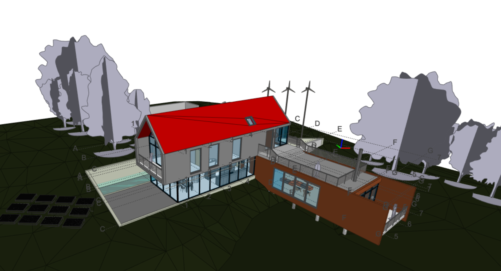
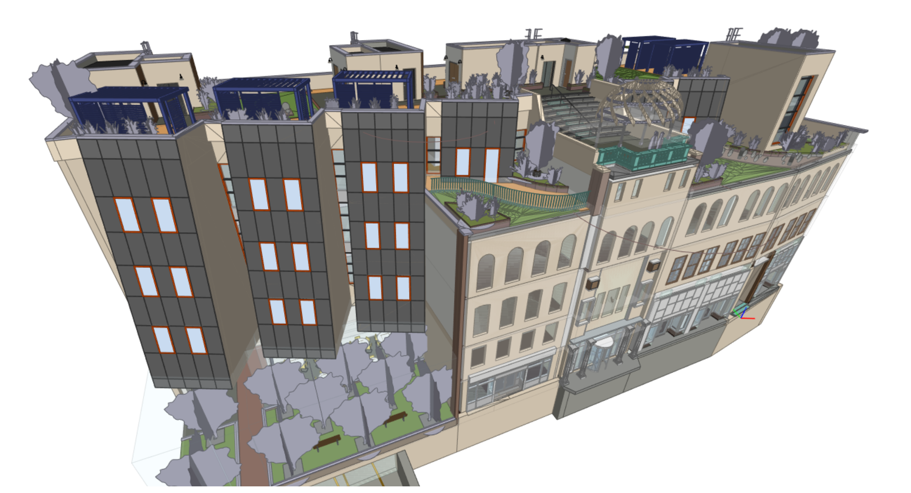

<p align="center">
  
</p>

RvtIO is a .NET library and command line tool that reads Autodesk Revit projects (`.rvt`) and families (`.rfa`) directly from disk, without Revit or the Revit API, and exports IFC and JSON.

## What it does

- Reads elements, parameters, geometry, file metadata and project information.
- Queries elements through `FilteredElementCollector`.
- Exports IFC2X3 coordination view, with optional Revit parameters as property sets.
- Writes compact JSON or a full JSON dump with every parameter and geometry.

## Install

Install the command line tool:

```sh
dotnet tool install --global RvtIO.Cli
```

Add the library to a .NET project:

```sh
dotnet add package RvtIO
```

The library targets .NET 8 and .NET 10. It uses managed code without native dependencies or Windows-only APIs and supports Windows, Linux and macOS. Tests currently run on Windows.

## Command line

Export a project to IFC:

```sh
rvtio project.rvt project.ifc
```

Export compact JSON:

```sh
rvtio project.rvt project.compact.json --compact-json
```

Export full JSON, including every parameter and geometry:

```sh
rvtio project.rvt project.full.json --json-full
```

Export IFC with Revit parameters as property sets:

```sh
rvtio project.rvt project.parameters.ifc --ifc-revit-parameters
```

A `.ifc` output path selects IFC. Any other output path selects JSON, which is compact by default. If the output path is omitted, the tool writes `output.json`. Diagnostics go to standard error.

Use `--ifc-revit-parameter-groups` for one property set per parameter group. Use `--resolve-current-copies` for a file saved in several increments: it keeps only the current copy of an element that more than one partition stream holds; without it every copy is decoded as before. Run `rvtio --help` for all options. Unknown options exit with code 1; options starting with `--dev-` are not a stable interface.

### Exit codes and the export report

| Code | Meaning |
| --- | --- |
| 0 | The export was written. |
| 1 | The command line is wrong. |
| 2 | The input cannot be read: it is missing, empty, not a compound file, or cut or damaged. One line on standard error, no stack trace. |
| 3 | A stream exceeded a limit of the reader and the read was cut. Nothing is exported unless `--allow-partial` is given. |
| 4 | The file is readable but a decoder failed on its content. |

`--report project.report.json` writes a machine-readable report: the fraction of each partition stream and of the element table that decoded, the streams cut by a limit, the elements the export left out with their class and reason, and the exported fraction. `--raise-limits` raises the limits for a very large model. A complete export without these options behaves as before. The report format and the limits are described in [the export report](docs/export-report.md).

## Library

Open a project, list wall instances through `FilteredElementCollector`, and export the document to IFC:

```csharp
using System;
using RvtIO;
using RvtIO.BuiltIns;
using RvtIO.Ifc;

var doc = RvtDocument.Open("project.rvt");

FilteredElementCollector walls = doc.Collector()
    .OfCategory(BuiltInCategory.OST_Walls)
    .WhereElementIsNotElementType();

foreach (var wall in walls)
{
    Console.WriteLine($"{wall.Id}: {wall.Name}");
}

new IfcExporter().Export(doc.RawData, "project.ifc");
```

The library is silent by default. Set `RvtReaderOptions.DiagnosticOutput` for reading or `IfcExporter.DiagnosticOutput` for export to receive diagnostics through a `TextWriter`.

See the [public API](docs/public-api.md) for the supported surface and [dependencies](docs/dependencies.md) for package details.

## Examples

IFC exports of sample models opened in an IFC viewer:

| Revit 2022 sample project | Revit 2025 sample project exported to IFC |
| --- | --- |
|  |  |

## Supported files

Reads `.rvt` projects and `.rfa` families. Testing covers sample projects saved by Revit 2020, 2021, 2022, 2023, 2024, 2025 and 2026. Revit 2027 files open with partial support.

The tested projects include basic and advanced architecture, structure and MEP samples, plus several larger multi-discipline models.

## Limitations

- Version 0.1.0 is a preview. The API can change before 1.0.
- Geometry coverage is partial for some element kinds.
- Revit 2027 support is partial.
- There is no support for writing or modifying Revit files.
- IFC output is limited to IFC2X3 coordination view.
- Output was compared with an independent reference exporter on the tested samples. Byte equality with Revit's own IFC export is not claimed.

## Build from source and tests

Use the .NET SDK selected by `global.json`, which specifies 10.0.100 with `latestFeature` roll-forward.

From the repository root:

```sh
dotnet build RvtIO.slnx -c Release
dotnet test
```

Tests requiring real Revit files are skipped with a message unless `RVTIO_TEST_FILES` points to a folder containing the private fixtures. The repository includes no Revit models.

Optional test variables are `RVTIO_REVIT_RESOURCES`, for a copy of Revit resource DLLs used to re-verify the built-in name tables, and `RVTIO_NATIVE_TABLE_DIR`.

## Contributing

See [CONTRIBUTING.md](CONTRIBUTING.md) and the [Code of Conduct](CODE_OF_CONDUCT.md). Release changes are recorded in [CHANGELOG.md](CHANGELOG.md).

## Security

Report vulnerabilities through GitHub private vulnerability reporting in the repository's Security tab. Do not open public issues for security vulnerabilities. See [SECURITY.md](SECURITY.md).

## License and trademarks

RvtIO is licensed under the [MIT License](LICENSE). Copyright holder: mahach666.

RvtIO is not affiliated with, endorsed by or sponsored by Autodesk. Autodesk and Revit are trademarks of Autodesk, Inc.

The file format is read by analysing files for interoperability. No Autodesk code or binaries are included.
